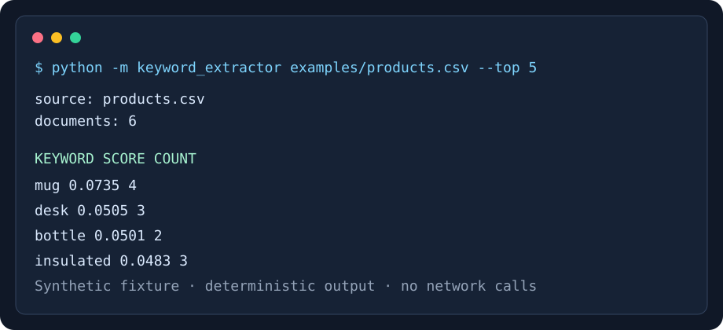

# Excel Keyword Extractor

A small, dependency-free Python tool that ranks useful keywords and two-word
phrases in `.xlsx` and `.csv` files. It is designed for repeatable spreadsheet
research: the same input and options always produce the same ordered result.



## What it demonstrates

- direct `.xlsx` parsing without Excel, LibreOffice, macros, or cloud services;
- weighted term-frequency / inverse-document-frequency scoring;
- configurable text columns, stop words, phrase extraction, and JSON/CSV output;
- bounded ZIP/XML parsing and clear validation errors;
- fully synthetic examples and deterministic unit tests.

## Quick start

Requires Python 3.11 or newer. No package installation is required.

```console
python -m keyword_extractor examples/products.csv --columns title description --top 8
python scripts/generate_demo_xlsx.py build/demo.xlsx
python -m keyword_extractor build/demo.xlsx --columns title description --format csv
python -m unittest discover -s tests -v
```

## CLI

```text
python -m keyword_extractor INPUT [--columns NAME ...] [--top N]
                            [--stop-word WORD ...] [--format json|csv]
                            [--output PATH] [--no-phrases]
```

If `--columns` is omitted, every non-empty column is analyzed. CSV input must
have a header row. XLSX input uses the first worksheet and supports shared and
inline strings. Password-protected files, formulas requiring recalculation, and
legacy `.xls` binaries are intentionally out of scope.

## How scoring works

For every spreadsheet row, selected cells are combined into one document.
Tokens are normalized to lowercase, stop words are removed, and optional
two-word phrases are added. A candidate score is the average normalized term
frequency multiplied by `log((1 + documents) / (1 + document_frequency)) + 1`.
Two-word phrases receive a modest `1.2` multiplier, and ties are resolved
alphabetically.

See [the architecture notes](docs/architecture.md) for data flow and trust
boundaries.

## Privacy and security

This repository contains only invented product descriptions. Input stays on the
local machine. The parser rejects oversized files and oversized expanded ZIP
content, and it never evaluates formulas or macros. Do not add customer
workbooks, credentials, personal data, or machine-specific paths.

## Project layout

```text
keyword_extractor/   library and CLI
examples/            synthetic input data
scripts/             synthetic workbook generator
tests/               unit and CLI tests
docs/                architecture and privacy-safe visual
```

## License

MIT. See [LICENSE](LICENSE).
