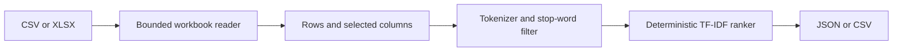

# Architecture

The workbook reader is the only component that touches untrusted files. It
checks the compressed input size and total expanded XLSX size before parsing.
Only cell text in the first worksheet is read; formulas, macros, relationships
other than the worksheet pointer, and embedded objects are not executed.

The ranking layer accepts plain strings and has no filesystem or network access.
The CLI validates requested columns, then serializes a stable result. Output is
written only to the explicit `--output` path or standard output.

## Deliberate limits

- `.xls`, password-protected files, charts, merged-cell semantics, and formula
  recalculation are not supported.
- The tool ranks terms; it does not claim semantic understanding.
- The default 20 MiB input / 50 MiB expanded limits favor interactive workloads.
